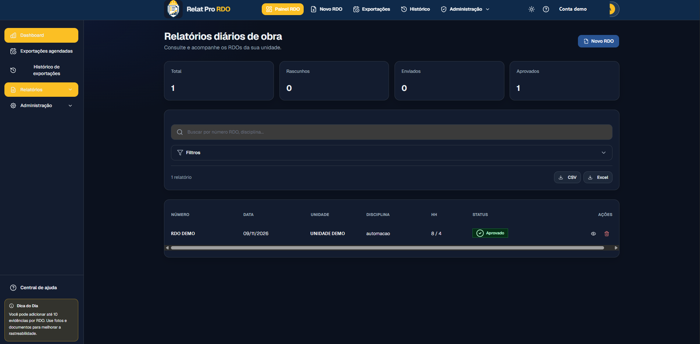
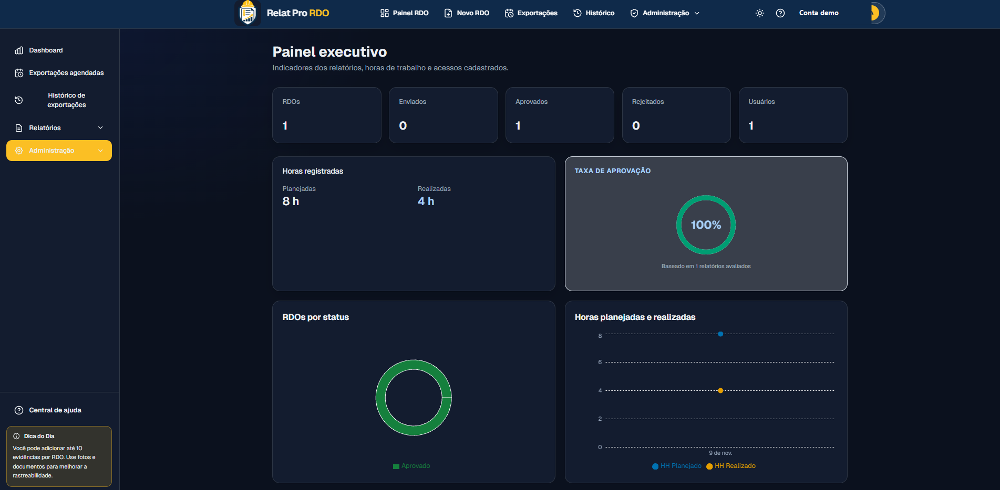
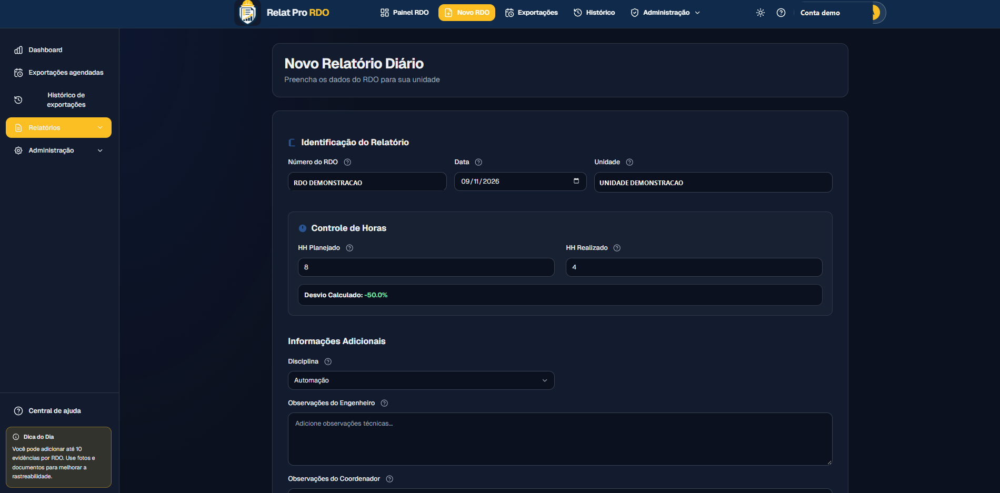
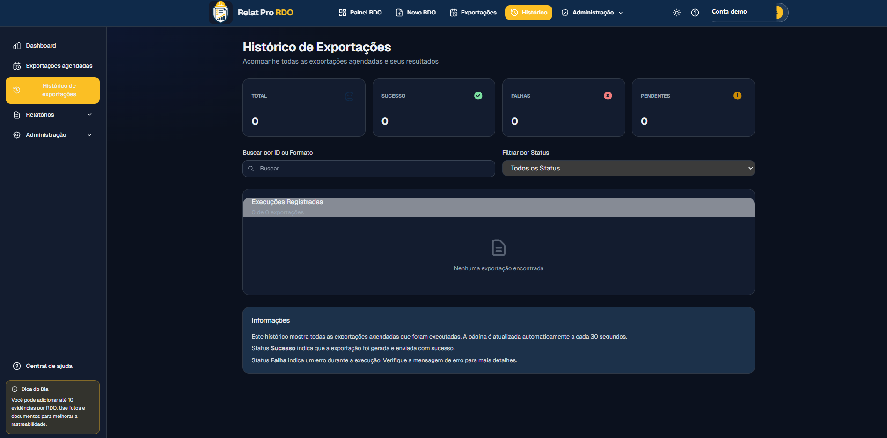

# Relat Pro RDO

> **Status:** em desenvolvimento ativo.

[](https://github.com/alberto2santos/relat-pro/actions/workflows/ci.yml)

Aplicação web para registrar e acompanhar Relatórios Diários de Obra (RDO), incluindo informações da obra, materiais, evidências e revisão por supervisores, engenheiros e administradores. O sistema usa React, TypeScript e Supabase e pode ser instalado como PWA em navegadores compatíveis.

[Repositório do Relat Pro RDO no GitHub](https://github.com/alberto2santos/relat-pro)

## Funcionalidades

- Criar, consultar, editar e revisar RDOs; relatórios aprovados não podem ser editados.
- Registrar materiais, horas, observações, fotos (incluindo captura pela câmera no celular) e assinatura.
- Apontar efetivo por função, equipamentos, ocorrências/paralisações e clima; o clima pode ser sugerido pela Open-Meteo usando coordenadas cadastradas na unidade.
- Duplicar materiais, funções e equipamentos do RDO anterior da mesma unidade e disciplina, zerando as horas realizadas e de uso.
- Pesquisar relatórios, acompanhar indicadores e exportar RDOs e seções operacionais em CSV, XLSX e PDF.
- Enviar RDOs aprovados ao endpoint configurado do TOTVS Protheus.
- Cadastrar exportações agendadas; sua execução automática exige configuração adicional de backend.
- Instalar como PWA e usar a interface responsiva em computadores, tablets e celulares.

## Capturas de tela

As imagens abaixo mostram as principais telas da aplicação. Os nomes de conta e dados de identificação foram substituídos por valores de demonstração.

<table>
  <tr>
    <td></td>
    <td></td>
  </tr>
  <tr>
    <td></td>
    <td></td>
  </tr>
</table>

## Uso offline

O formulário pode ser usado sem conexão depois que a pessoa autentica e carrega as unidades ao menos uma vez online.

- Rascunhos, fotos e assinatura ficam neste dispositivo, separados por usuário, no armazenamento do navegador. Esses dados não são criptografados pela aplicação.
- A gravação do RDO e dos dados operacionais é atômica e usa versão-base; conflitos de edição não sobrescrevem o servidor e exigem resolução explícita.
- Ao finalizar offline, o RDO é sincronizado e enviado para revisão depois que os dados e os arquivos forem salvos, quando a conexão voltar, com o app aberto ou na próxima abertura. Não há envio com o navegador totalmente fechado.
- Se a sincronização falhar, a submissão, os estados por arquivo e o motivo permanecem localmente. Falhas de conexão podem ser repetidas automaticamente; conflitos e erros permanentes ficam bloqueados até resolução ou nova tentativa manual. Ainda não há painel central para consultar todas as pendências.
- Sair da conta não apaga nem bloqueia o acesso aos dados locais. Limpar os dados do navegador ou a remoção de armazenamento pelo sistema, especialmente no iOS, pode apagar itens ainda não sincronizados.

Mais detalhes e limitações em [Arquitetura e regras de negócio](docs/arquitetura.md).

## Executar localmente

### Pré-requisitos

- Node.js `^20.19.0` ou `>=22.12.0`
- npm
- Projeto Supabase remoto ou Docker Desktop e Supabase CLI para desenvolvimento local

```bash
git clone https://github.com/alberto2santos/relat-pro.git
cd relat-pro
npm install
```

Crie `.env.local` copiando `.env.example` e informe as credenciais públicas do Supabase:

```dotenv
VITE_SUPABASE_URL=https://SEU_PROJECT_REF.supabase.co
VITE_SUPABASE_ANON_KEY=SUA_CHAVE_PUBLICA
```

No PowerShell, copie o exemplo com `Copy-Item .env.example .env.local`. No Linux, macOS ou Git Bash, use `cp .env.example .env.local`.

Use somente uma chave pública `anon` ou `publishable` nas variáveis `VITE_`; nunca inclua chaves `service_role` ou `secret` no frontend.

```bash
npm run dev
```

Abra <http://localhost:3000>. Para preparar o banco, criar o primeiro administrador, configurar autenticação ou iniciar o Supabase local, consulte [Configuração do Supabase](docs/supabase.md).

## Implantar na Vercel

Importe o repositório na Vercel. O projeto usa `npm run build` e a pasta `dist` como saída; o arquivo `vercel.json` configura o fallback das rotas da aplicação. Cadastre `VITE_SUPABASE_URL` e `VITE_SUPABASE_ANON_KEY` nas variáveis de ambiente do projeto antes de implantar.

O pacote `@vercel/analytics` já está integrado ao app. Para receber métricas, habilite **Web Analytics** nas configurações do projeto na Vercel e faça uma nova implantação.

## Documentação

- [Configuração e operação do Supabase](docs/supabase.md) — migrations, Auth, convites, ambiente local e testes.
- [Integração com TOTVS Protheus](docs/integracao-protheus.md) — contrato, segredos, reenvios e diagnóstico.
- [Arquitetura e regras de negócio](docs/arquitetura.md) — tecnologias, estrutura, perfis, estados e limitações.
- [Contribuição](CONTRIBUTING.md) — validações e orientações para mudanças.

## Comandos

| Comando | Descrição |
| --- | --- |
| `npm run dev` | Inicia o servidor de desenvolvimento na porta 3000. |
| `npm run build` | Verifica os tipos TypeScript e gera a aplicação em `dist/`. |
| `npm run preview` | Abre uma prévia local da versão de produção. |
| `npm run lint` | Executa o ESLint. |
| `npm test` | Executa os testes unitários Vitest. |
| `npm audit` | Verifica vulnerabilidades conhecidas nas dependências npm. |

## Licença

MIT. Consulte [LICENSE](LICENSE).
